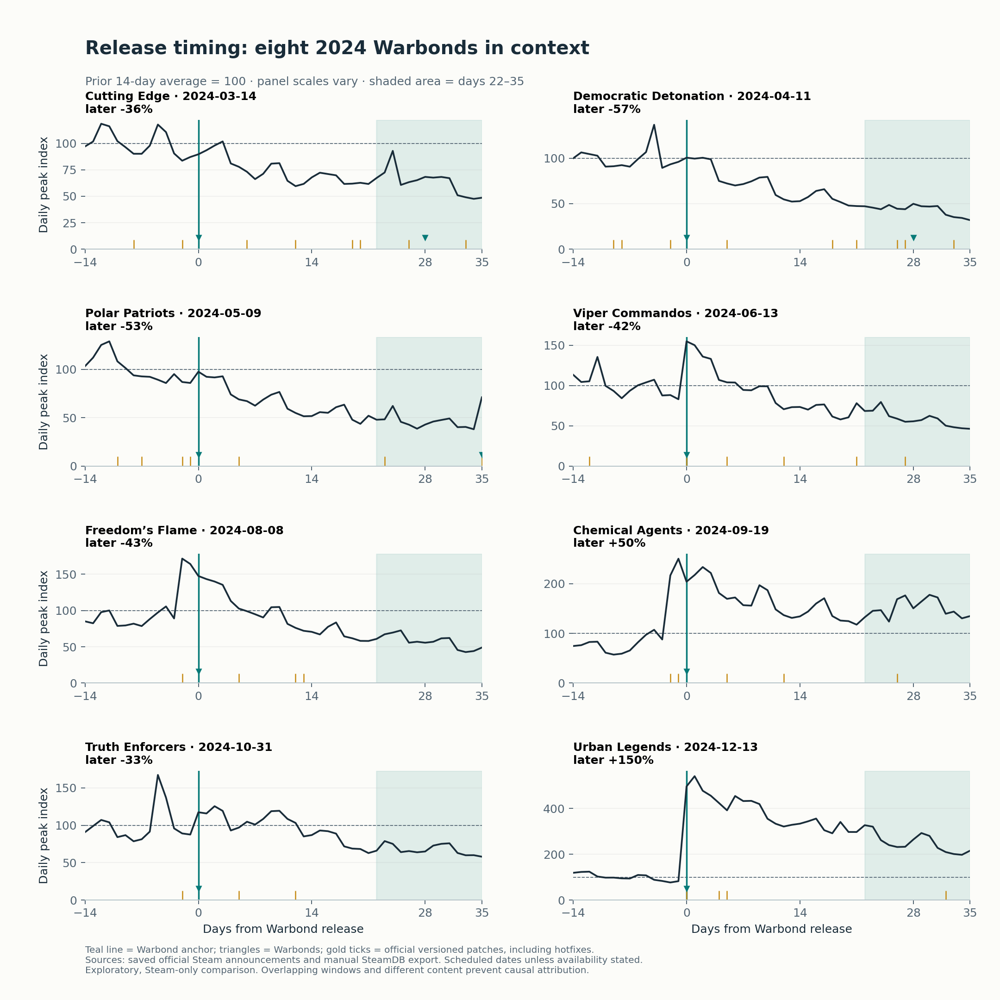

# Helldivers 2 | LiveOps content timing
**Hansen Cheng · Independent product management case study**

Was spacing patches and Warbond releases associated with sustained Steam activity? I compared eight post-launch 2024 Warbonds using a manual SteamDB export and official Steam announcements.

**Finding:** similar release gaps had different outcomes. Four of five releases with a two-day patch gap had later activity below baseline; same-day releases also had mixed results. I recommend a consistent 35-day release review, considering content scope and nearby updates, before choosing a standard gap. This is an association study, not a causal effect or player-retention estimate.

## Start here
- **[Final case study](case-study/Hansen_Cheng_Helldivers2_Case_Study.pdf)** — four pages, including the two-page Power BI report.
- **[Excel analysis](curated/hd2_data.xlsx)** — start with **Content timing** and **Timing evidence**.
- **[Findings and methods](case-study/content_timing.md)** — definitions, results, sensitivity and alternative explanations.
- **[Project documentation](confluence/index.md)** — question, evidence, options, recommendation and decisions.
- **[Repository guide](REPO_GUIDE.md)** — where files live and how to trace a finding.
- **[Shared project folder](https://drive.google.com/drive/folders/1wVaIBivC-GvVmfpe_5eOa8xT3k8pQy-Y?usp=sharing)** and **[live documentation links](case-study/Hansen_Cheng_HD2_Live_Links.pdf)**.



## Measures and limits
The baseline is the mean daily Steam peak over days -14 to -1. Launch response is the maximum on days 0–3; later activity is the mean on days 22–35. Weekly means provide intermediate checkpoints. Percent changes use the same baseline. A maximum and a mean are different summaries; their difference is not a retention or drop-off rate.

Patch gap starts at the earliest official versioned patch in the seven days before or on the Warbond date, including hotfixes. Content scope, other updates, promotions and existing activity trends can overlap these windows. All eight releases have complete main windows; 7-day and 28-day baselines preserve the direction of later activity.

The snapshot contains 970 historical daily peak dates through October 4, 2026. The next 30 complete calendar dates contain intraday samples and are kept separate. The export lacks timezone metadata; the UTC chart-day interpretation is inferred and remains a disclosed limitation. Steam activity excludes consoles and does not measure unique players, individual retention, purchases or revenue. See [sources](SOURCES.md) and the [data dictionary](data_dictionary.md).

## Project structure
| Folder | Purpose |
|---|---|
| `case-study/` | Final PDF, editable LaTeX, native Power BI PDF and live links |
| `confluence/` | Local documentation; shared pages were published separately |
| `curated/` | Cleaned datasets and Excel workbook |
| `inputs/` | Reviewed release dates and optional correction/judgment inputs |
| `raw/` | Saved public evidence and provenance; private SteamDB files are ignored |
| `src/` | Collection, curation, calculations, workbook generation and validation |
| `outputs/` | Calculated scorecards, sensitivity tables, charts and validation report |
| `powerbi/` | Description of the completed browser-built report |
| `jira/` | Completed backlog and actual HD2LO key mapping |
| `tests/` | Window, missing-data and patch-gap checks |

The original three-event comparisons remain as supporting research because the workbook and validation pipeline use them. They are separate from the final eight-Warbond comparison.

## Reproduce the analysis
Use Python 3.11 or later (tested with 3.12). Run from the repository root. The supplied public snapshots are cached; the original private SteamDB CSV must be supplied separately to regenerate player data. See [input handling](inputs/README.md).

```sh
python3.12 -m venv .venv
source .venv/bin/activate
python -m pip install -r requirements.txt
python src/collect.py reviews patches news
python src/curate.py
python src/validate.py --stage data
python src/analyze.py
python src/content_timing.py
python src/workbook.py
python src/validate.py
python -m unittest discover -s tests
```

On Windows, activate with `.venv\Scripts\Activate.ps1`. Stop if validation fails. Cached collection reuses saved responses; `--refresh` explicitly acquires new snapshots. Do not regenerate over manual workbook edits: import a reviewed copy first using the [input workflow](inputs/README.md). After changing data, review the written findings and refresh Power BI separately; the Python pipeline does not update the live report or Confluence.

Build the submission PDF with `make -C case-study pdf`; see the [LaTeX guide](case-study/README.md).

## Delivery status
The analysis, Excel workbook, browser-built Power BI report and final PDF are complete. The owner confirmed Jira completion, Confluence publication and Drive access checks in this session. The repository records the actual Jira keys and supplied shared links; it does not continuously synchronize with those services.

The proposed game-team release-review process has not been implemented. This project is independent of Arrowhead, Sony, Valve and SteamDB.
