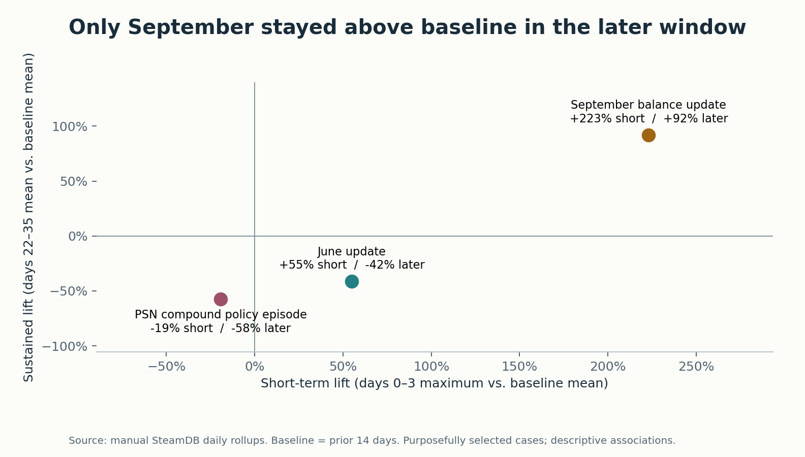

# Helldivers 2 | LiveOps decision review
**Author: Hansen Cheng**

Which event deserves a deeper product investigation after the launch spike fades? This independent case study compares three verified events in Steam activity and review sentiment, then proposes one testable next step for a LiveOps producer.



**Current direction: content timing, selected November 5, 2026.** An exploratory extension compares eight 2024 Warbond releases. Similar patch-to-content gaps had mixed later activity, so the recommendation is to evaluate whole release sequences at launch, weekly and later checkpoints before changing cadence. [Content-timing findings and methods](case-study/content_timing.md). The study does not identify individual returning players or isolate any release’s effect. Final wording remains under owner review.

| Event (2024) | Short-term lift | Sustained lift | Month vs prior month, positivity |
|---|---:|---:|---:|
| June 13 · PATCH 01.000.400 | +54.9% | −41.5% | +49.0 pp |
| September 17 · Patch 1.001.100 | +223.1% | +92.1% | +34.6 pp |
| May 3–6 · PSN announcement and reversal | −19.2% | −57.6% | −54.7 pp |

Short-term compares the days 0–3 maximum with the prior 14-day mean of Steam peak concurrent players. Sustained compares the days 22–35 mean with the same baseline. All nine main windows are complete, and the signs are unchanged with 7- and 28-day baselines. The June Warbond shared the anchor date, the October balance pass overlaps September's later window, and May's monthly histogram cannot separate announcement from reversal. [Three case studies and source links](confluence/02_evidence_and_event_studies.md) · [Scorecard](outputs/impact_scorecard.csv)

## Read or review
- [Portfolio case study](case-study/case_study_draft.md) and [product proposal](confluence/04_recommendation_and_measurement_plan.md)
- [Excel review workbook](curated/hd2_data.xlsx) (Content timing and Timing evidence contain the eight-release extension), [figures](outputs/charts/), [validation](outputs/validation_report.csv), [source register](SOURCES.md) and [dictionary](data_dictionary.md)
- [Two-page Power BI guide](powerbi/build_guide.md), [Jira handoff](jira/jira_setup.md), [Confluence publishing guide](confluence/index.md) and [ordered human checklist](TODO_HUMAN.md)

```text
Manual SteamDB export + Steam histogram + news + wiki
             ↓ immutable raw snapshots and checksums
Curated daily peaks, releases, events and monthly reviews
             ↓ verified windows, coverage and sensitivity
Python scorecard → Excel review / charts / Power BI build kit
             ↓ alternatives, uncertainty and internal data needed
One draft discovery proposal → owner review and decision
```

## Reproduce from the repository root
Use Python 3.11 or later (tested on 3.12). Direct dependencies are pinned. The delivery includes the public source snapshots. The private SteamDB export is excluded from Git. To reproduce the player metrics on another machine, place the original file in raw/ as steamdb_chart_553850.csv or steamdb_553850.csv. See [manual intake and review](inputs/README.md). Missing or unsuitable input leaves dependent results blank.

```sh
python3.12 -m venv .venv
source .venv/bin/activate
python -m pip install -r requirements.txt
python src/collect.py reviews patches news
python src/curate.py
python src/validate.py --stage data
python src/analyze.py
python src/content_timing.py
python src/workbook.py
python src/validate.py
python src/make_jira_csv.py
python -m unittest discover -s tests
```

On Windows use `py -3.12 -m venv .venv` and activate with `.venv\Scripts\Activate.ps1`. Each command resolves data relative to this repository. Stop if validation fails. The existing virtual environment in this checkout is ready to use. The workbook can be rebuilt with the pinned Python dependencies. Set HD2_RUNTIME only when using an optional external workbook rendering runtime.

Reruns reuse cached URL responses and immutable snapshots. To acquire new versions use `python src/collect.py reviews patches news --refresh`; retrieval times, checksums and paths are separately recorded. A failed refresh retains prior active usable snapshots where possible. Curation and analysis read local evidence. Excel edits require an explicit import before regeneration. The human-written input CSVs, editorial pages and master backlog are never regenerated over reviewed work. Narratives are dated snapshots; re-review them if changing data, inputs, or event mappings.

## Delivered snapshot
The calendar covers all 1,000 complete UTC dates from February 8, 2024 through November 3, 2026. The inspected export supplies 970 consecutive historical daily rollups through October 4, 2026. The remaining 30 complete dates contain intraday samples and are shown separately. The CSV does not encode its timezone. The UTC chart-day grouping and peak interpretation are empirical, supported by its paired average series and the exact February 24 record match. Confirm these with the chart owner before final publication.

Steam returned 825 news IDs (169 game-feed announcements), with sufficient coverage back through launch. The wiki version table parsed successfully. Official mappings take precedence for the selected cases. The histogram returned 34 monthly rollups, of which 32 full months enter comparisons. The 30 recent daily buckets overlap monthly data and do not cover May 2024. The endpoint returned count_all_reviews=false; the review-language population and off-topic exclusion rules are unknown. [Snapshot details](curated/coverage.json)

The project is independent of Arrowhead, Sony, Valve and SteamDB. The proposed measurements, qualitative effort assumptions, draft priorities and experiment are unapproved. Native Power BI assembly, account imports, research and publishing are owner tasks. [Project brief](project_brief.md) · [Implementation plan](PLAN.md)
