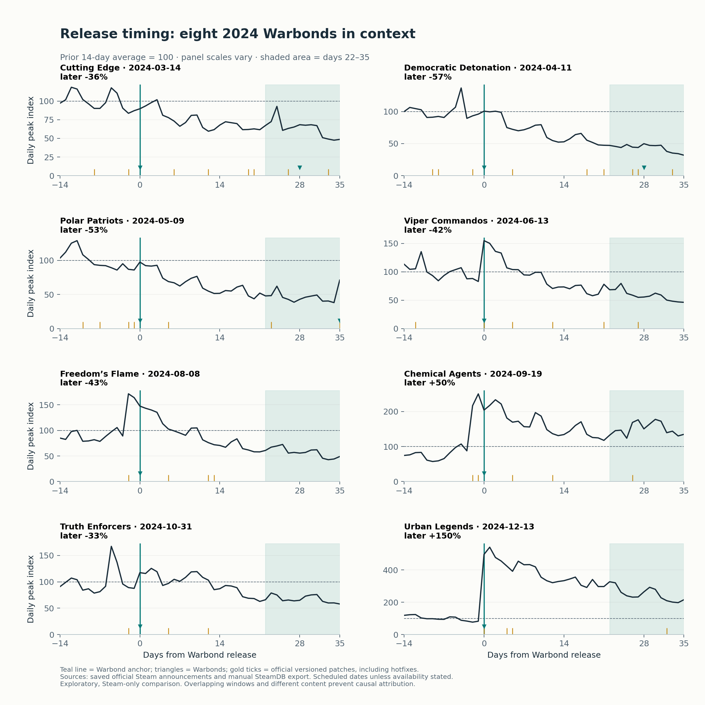

# Does spacing patches and Warbonds sustain player activity?

**Exploratory extension · November 5, 2026.** Hansen selected content timing as the next investigation after seeing the original three cases. This extension is retrospective, not a preregistered test. It uses the existing saved source snapshot; no internal player data is available.

## Decision and finding

Use launch, weekly and later activity checks to evaluate each release sequence. The observed spacing alone does not establish a better schedule. Of the five Warbonds released two days after the start of a nearby patch cluster, only Chemical Agents had a later average above baseline. Same-day releases also had opposite outcomes: Viper Commandos declined while Urban Legends increased alongside Omens of Tyranny. This supports evaluating content scope and overlapping releases before adopting a fixed gap.

## Expanded sample

The sample contains the eight post-launch Premium Warbond releases identified in the saved official Steam announcement feed during calendar 2024. It extends the original 2024 cases within the same launch year. Launch-day Warbonds are excluded because they lack a pre-launch player baseline. The December Killzone collaboration is separately recorded in the news timeline and is not classified as a Warbond by its saved announcement. No cases were excluded for an unfavorable activity result. This is a small historical sample, not a representative experiment or an analysis of 2025–2026.

| Warbond | Release date | Patch-cluster gap | Launch maximum vs baseline | Later average vs baseline |
|---|---|---:|---:|---:|
| [Cutting Edge](https://steamstore-a.akamaihd.net/news/externalpost/steam_community_announcements/5679673637652370629) | 2024-03-14 | 2 days | +1.8% | -36.5% |
| [Democratic Detonation](https://steamstore-a.akamaihd.net/news/externalpost/steam_community_announcements/5756237364308655582) | 2024-04-11 | 2 days | +0.6% | -56.8% |
| [Polar Patriots](https://steamstore-a.akamaihd.net/news/externalpost/steam_community_announcements/5766372999943498700) | 2024-05-09 | 7 days | -2.5% | -52.8% |
| [Viper Commandos](https://steamstore-a.akamaihd.net/news/externalpost/steam_community_announcements/5746109972548721060) | 2024-06-13 | 0 days | +54.9% | -41.5% |
| [Freedom’s Flame](https://steamstore-a.akamaihd.net/news/externalpost/steam_community_announcements/5963413094366479432) | 2024-08-08 | 2 days | +47.6% | -42.8% |
| [Chemical Agents](https://steamstore-a.akamaihd.net/news/externalpost/steam_community_announcements/6250522009513151638) | 2024-09-19 | 2 days | +133.4% | +50.4% |
| [Truth Enforcers](https://steamstore-a.akamaihd.net/news/externalpost/steam_community_announcements/6212245217911822084) | 2024-10-31 | 2 days | +25.5% | -32.7% |
| [Urban Legends](https://steamstore-a.akamaihd.net/news/externalpost/steam_community_announcements/1785774543554310) | 2024-12-13 | 0 days | +441.3% | +150.2% |

These results are anchored on the **Warbond date**, not the patch date. Chemical Agents therefore shows +50.4% later activity here; the original September 17 patch case shows +92.1%. The two-day shift changes both the baseline and follow-up dates. Both calculations are valid descriptions of different windows. Neither estimates the effect of the Warbond.

## Methods and checks

- Baseline: average daily Steam peak on days −14 to −1. Launch: maximum on days 0–3. Later: average on days 22–35. A maximum and an average answer different questions and must not be treated as a retention funnel.
- Weekly averages on days 0–6, 7–13 and 14–20 provide additional checks using means. Each metric requires every daily observation in its window. All eight cases have complete baseline, launch, weekly and later windows in the historical daily portion of the export.
- Release dates come from the body of each official announcement. Most are scheduled dates rather than independently confirmed deployment timestamps; Urban Legends explicitly states same-day availability. Announcement dates are kept separately in the source ledger.
- Patch-cluster gap is a mechanical descriptive field: days from the earliest officially documented versioned patch in the seven days up to and including the Warbond release. It includes hotfixes and does not imply a planned content bundle or equal patch scope. All eight have a patch in this range. Chemical Agents follows the September 17 patch by two days and the September 18 hotfix by one day; Polar Patriots has several patches in its preceding week.
- To check whether pre-Warbond patch activity contaminates the baseline, a second score starts at that cluster date and recomputes both baseline and follow-up windows. The later direction stays the same for all eight cases. These shifted windows are a sensitivity check, not an isolated patch estimate.
- Seven- and 28-day baseline alternatives also preserve the later direction for all eight. Chemical Agents ranges from +16.2% to +59.6% under those alternatives, illustrating that magnitude is sensitive even when direction is stable.

## Competing explanations

June combines a mixed patch and Viper Commandos. August includes Escalation of Freedom, whose official notes describe new enemies, objectives and difficulty alongside balance changes. September combines a balance overhaul, hotfixes, Chemical Agents and the October 15 balance pass inside the later window. December combines Urban Legends with Omens of Tyranny, which introduces the Illuminate and colony missions, followed by the Killzone collaboration. The same-day category therefore combines very different content packages.

May overlaps the account-linking controversy and an already declining player series. Broader lifecycle trends, baseline size, holiday timing, prices/promotions, marketing and evolving content quality may differ across cases. The saved feed does not constitute an exhaustive calendar of promotions or in-game events. Windows overlap and reuse daily observations; cases are not statistically independent. There are only two same-day and five two-day examples, plus one seven-day cluster. A category average or significance test would suggest more comparability than this design supports.

## Recommendation for a producer

**Adopt a release-sequence review with launch, weekly and later checkpoints before changing cadence.** Record patch scope, Warbond date, neighboring releases and the pre-release trend alongside the activity curve. Use the pre-sequence baseline when patches precede content, and display the Warbond-anchored result as a sensitivity check. Require repeated patterns among comparable release scopes before proposing a fixed timing rule. The current study does not establish an optimal interval or justify a production schedule change.

This recommendation is feasible with public evidence and provides a reusable planning review. It does not require pretending that player-level data exists. A game team could later add returning-player cohorts, mission behavior, sales and production costs to decide whether an observed activity association creates business value. Those are future internal validation steps, not completed work.

## Reproduce and audit

Run `.venv/bin/python src/content_timing.py`. The source ledger is [content_releases_2024.csv](../inputs/content_releases_2024.csv), including exact date cues, news IDs and immutable source paths. The outputs are the [timing scorecard](../outputs/content_timing_scorecard.csv), [baseline sensitivity](../outputs/content_timing_sensitivity.csv) and [daily event timeline](../outputs/content_timing_timeline.csv). Official patch provenance remains in [releases](../curated/releases.csv); other announcements remain in [events](../curated/events.csv). The chart marks official versioned patches and the eight 2024 Warbonds; it is not a complete marketing calendar. Existing timezone and Steam-only limitations still apply.
