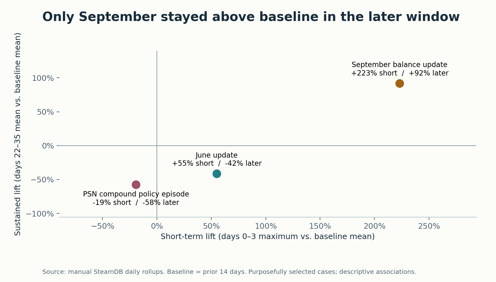

# September kept more of its initial increase
This page records the November 3, 2026 analysis snapshot. For each case, compare daily Steam peaks across three windows. The baseline is the prior 14-day average. The launch statistic is the largest daily peak on days 0–3. The later statistic is the average of daily peaks on days 22–35. Every selected anchor has 14, 4 and 14 observations respectively. Lift is relative to the same baseline. [Scorecard](../outputs/impact_scorecard.csv) · [Source register](../curated/source_register.csv)

| Anchor | Prior average | Four-day maximum | Later average | Short lift | Sustained lift | Change in monthly positive share |
|---|---:|---:|---:|---:|---:|---:|
| June 13 · PATCH 01.000.400 | 59,175 | 91,692 | 34,615 | +54.9% | −41.5% | +49.0 pp |
| September 17 · Patch 1.001.100 | 21,165 | 68,380 | 40,651 | +223.1% | +92.1% | +34.6 pp |
| May 3 · PSN episode | 151,731 | 122,641 | 64,271 | −19.2% | −57.6% | −54.7 pp |

## June 13 — mixed balance, feature and stability release
**Observed.** The official patch is titled PATCH 01.000.400. Its notes discuss loadout variety, supply lines, invite-only lobbies and crash fixes. A separate same-day explanation links to the same release. Viper Commandos was scheduled for that same date. The baseline spans May 30–June 12, launch June 13–16, and follow-up July 5–18. Patch 1.000.405 falls inside the later window. [Official patch](https://steamcommunity.com/games/553850/announcements/detail/4150709804553746158) · [Viper Commandos announcement](https://steamstore-a.akamaihd.net/news/externalpost/steam_community_announcements/5746109972548721060)

**Interpretation.** The larger launch maximum coexisted with a later mean well below baseline. Activity was already trending down: the last seven baseline days averaged 9.8% less than the first seven. June had 10,634 reviews, of which 82.4% were positive. May had 343,328, with 33.4% positive. Comparing June to an exceptional policy month magnifies the change in positive share. Neither the player signal nor review mix isolates the contribution of the patch. [June timeline](../outputs/charts/june_2024_timeline.png) · [Monthly reviews](../curated/reviews.csv)

## September 17 — armor and loadout overhaul
**Observed.** Patch 1.001.100 reworked anti-tank weapons, armor and enemy health. The team described a goal of making more equipment viable. Baseline September 3–16 includes the September 5 progress announcement. Launch September 17–20 includes the September 18 shield/crash hotfix and September 19 scheduled Chemical Agents Warbond. October 15's balance pass falls within the October 9–22 later window. The hotfix's official title says HOT FIX 01.001.001; the wiki uses 1.001.101 for the matching shield and host-migration fixes. One event is counted. [Official patch](https://steamcommunity.com/games/553850/announcements/detail/7147864422081646860) · [Wiki hotfix](https://helldivers.wiki.gg/wiki/1.001.101) · [Chemical Agents announcement](https://steamstore-a.akamaihd.net/news/externalpost/steam_community_announcements/6250522009513151638)

**Interpretation.** The largest proportional increase starts from the smallest baseline of the three. The later mean remained 92.1% above it, including activity after the October follow-up patch. The second half of the prior fortnight was already 5.2% above the first. September's review share rose from August's 39.6% to 74.2%, while review volume fell from 12,588 to 6,755. An investigation should test returning-player behavior, content exposure and equipment choice with internal data. [September timeline](../outputs/charts/september_2024_timeline.png)

## May 3–6 — compound PSN policy episode
**Observed.** Sony announced a future linking requirement on May 3, then edited the same post on May 6 to withdraw the rollout. The effective dates described in the original notice were proposals. May 3 anchors the single case. April 19–May 2 precedes it, May 3–6 contains both messages, and May 25–June 7 is the later window. Patches on April 29 and May 2 also fall in the baseline. The second half of that baseline was already 13.8% lower than the first. [Official announcement and amendment](https://steamcommunity.com/games/553850/announcements/detail/4196868529806518742)

**Interpretation.** Even the maximum of the four launch days was below the prior daily mean. Monthly reviewers posted 114,571 positive and 228,757 negative recommendations in May. The share fell from 88.0% in April to 33.4% in May. The histogram has no daily May 2024 buckets. It cannot distinguish the two messages, reveal who lost access, or establish why the activity decline continued. Polar Patriots was scheduled for May 9 and several patches fell between the comparison windows. [May timeline](../outputs/charts/psn_2024_timeline.png)

## Sensitivity and alternative explanations
| Case | Short lift, 7d / 28d baselines | Sustained lift, 7d / 28d baselines |
|---|---:|---:|
| June | +63.3% / +35.6% | −38.3% / −48.8% |
| September | +215.1% / +195.7% | +87.3% / +75.8% |
| May | −12.7% / −36.7% | −54.2% / −66.9% |

All signs hold, while magnitudes depend on baseline choice. Four-day maxima and fortnight means sample weekdays differently. Existing trends, weekends, the age of the game, squad coordination and competing content can affect activity. Sale exposure and seasonal effects have not been established for these windows. Do not treat an unverified promotion as an observed confounder. Public aggregates do not track a returning cohort. Steam's count_all_reviews=false flag is preserved, while review-language and off-topic rules remain uncertain. [Sensitivity checks](../outputs/sensitivity_checks.csv) · [Monthly review chart](../outputs/charts/monthly_reviews.png)

Hypothesis assessments remain blank pending the owner's retrospective wording and thresholds. There is no causal counterfactual or representative sampling of update categories.
